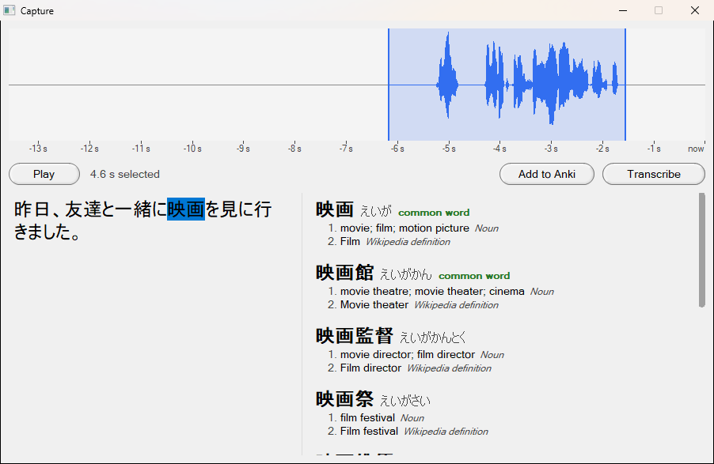
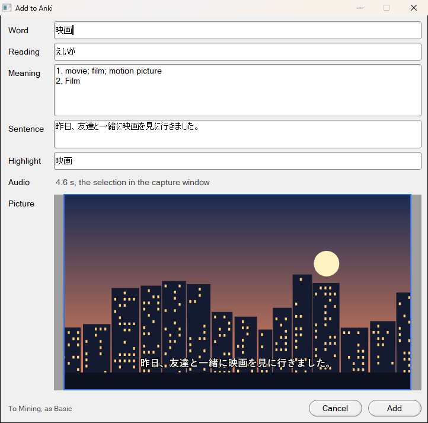

# Hearstash

Turn words you hear into flashcards.


A desktop app for learning Japanese from what you watch. It keeps the last
few seconds of whatever your computer is playing (anime in mpv, a YouTube
video, a stream). When you miss a line, press a shortcut and you can:

1. see the audio as a waveform and select the line, then play it back to
   check it,
2. transcribe the selection with [whisper.cpp](https://github.com/ggml-org/whisper.cpp),
   which runs on your own machine,
3. select any word in the transcript to look it up on Jisho,
4. add it to Anki as a card with the sentence, the audio clip and a
   cropped screenshot of the moment.

The fast path is **shortcut → Enter → read**. Everything else is optional.

For games and visual novels, a second shortcut reads the text on the
screen instead (OCR, with [PaddleOCR](https://github.com/PaddlePaddle/PaddleOCR)'s
models, also on your own machine), into the same kind of window: look
words up, translate, and add cards the same way.

The main window is also a lookup tool: type or paste text, or record it
from the microphone (Record Input in the **+** menu), and search Jisho, DeepL or MyMemory. Successful
searches are kept in a history window.

It's written in C++23 with [FLTK](https://www.fltk.org/), and runs on
Windows and Linux. [PLAN.md](PLAN.md) has the design, what's done, and
what's still to try.

## Building

### Dependencies

Installed on the system:

- CMake 3.21 or newer, and a C++23 compiler (GCC or MinGW)
- FLTK (1.4 recommended)
- libcurl
- nlohmann_json 3.11 or newer
- libjpeg-turbo
- pkg-config
- On Linux: libpng, for screenshots from the desktop's screenshot portal
- Optional, on Linux: `wayland-client`, for a clipboard that works under
  Wayland
- Optional, on Linux: libsystemd (its sd-bus), for screenshots on KDE,
  GNOME and X11. Without it, screenshots only work with grim
- Optional: Vulkan, to run whisper on the GPU (NVIDIA, AMD or Intel),
  about 5 times faster. Building it takes the Vulkan headers and loader,
  `glslc` and SPIRV-Headers (Arch: `vulkan-headers`, `vulkan-icd-loader`,
  `shaderc`, `spirv-headers`). It's used when they're all found; pass
  `-DHEARSTASH_GPU=OFF` to build for the CPU only, or `ON` to fail without
  them. The app then needs the Vulkan loader to start, which GPU drivers
  install. With no GPU, or not enough free video memory for the model,
  it transcribes on the CPU
- Optional: [onnxruntime](https://onnxruntime.ai/), to read text on the
  screen (Arch: `onnxruntime-cpu`; elsewhere Microsoft's prebuilt package,
  passed to CMake as `-DONNXRUNTIME_ROOT=<its folder>`). Without it, the
  screen capture says it can't read

Built with the app, as git submodules in `external/`:

- [whisper.cpp](https://github.com/ggml-org/whisper.cpp), for speech to text
- [miniaudio](https://github.com/mackron/miniaudio), for recording and playback

Fetch the submodules first:

```bash
git submodule update --init
```

### Linux

```bash
cmake -B build -DCMAKE_BUILD_TYPE=Release
```

```bash
cmake --build build -j
```

### Windows (MinGW + vcpkg)

Install curl, nlohmann-json and libjpeg-turbo with vcpkg's
`x64-mingw-static` triplet, and point `CMAKE_PREFIX_PATH` at an FLTK
build. `-static` links everything into one `.exe`:

```bash
cmake -B build -G "MinGW Makefiles" -DCMAKE_TOOLCHAIN_FILE=C:/vcpkg/scripts/buildsystems/vcpkg.cmake -DVCPKG_TARGET_TRIPLET=x64-mingw-static -DVCPKG_HOST_TRIPLET=x64-mingw-static -DCMAKE_PREFIX_PATH=C:/deps/fltk -DCMAKE_EXE_LINKER_FLAGS=-static
```

```bash
cmake --build build -j
```

That build is tuned for your own CPU. To make an `.exe` you can send to
other people, turn off `GGML_NATIVE` and target the AVX2 instruction set
instead. Any x64 PC from about 2013 or later supports it. `-s` strips the
debug symbols:

```bash
cmake -B build-dist -G "MinGW Makefiles" -DCMAKE_BUILD_TYPE=Release -DCMAKE_TOOLCHAIN_FILE=C:/vcpkg/scripts/buildsystems/vcpkg.cmake -DVCPKG_TARGET_TRIPLET=x64-mingw-static -DVCPKG_HOST_TRIPLET=x64-mingw-static -DCMAKE_PREFIX_PATH=C:/deps/fltk "-DCMAKE_EXE_LINKER_FLAGS=-static -s" -DGGML_NATIVE=OFF -DGGML_AVX=ON -DGGML_AVX2=ON -DGGML_FMA=ON -DGGML_F16C=ON -DGGML_BMI2=ON
```

```bash
cmake --build build-dist -j --target hearstash
```

`build-dist/hearstash.exe` then runs on its own. It only uses DLLs that
come with Windows 10 and 11.

### Tests

The parts that don't need an audio device or a window have plain test
executables:

```bash
ctest --test-dir build
```

## Setting it up

Everything is in **Settings**:

- **Speech-to-Text**: download a whisper model and choose it. `small` is a
  good start; `large-v3-turbo-q5_0` picks kanji much better but is slower.
  Downloads are checked against their SHA-1. It runs on the GPU unless you
  untick **Transcribe on the GPU**, e.g. to leave a game all the video
  memory. You can also choose the microphone here.
- **Buffer**: turn the rolling buffer on or off, set how many seconds it
  keeps (and how much of the end is selected when a capture opens), and
  set the capture shortcut.
- **Anki**: choose the deck and note type, and which field gets the word,
  reading, meaning, sentence, audio and picture. The note type is
  Hearstash's own unless you pick another: the sentence on the front, the
  word, meaning, audio and picture on the back, in large Japanese type. It's
  added to Anki with your first card. With another note type, fields are
  guessed from their names. Needs Anki running with the
  [AnkiConnect](https://ankiweb.net/shared/info/2055492159) add-on.
- **API**: your DeepL key (free or Pro). It can also come from the
  `DEEPL_API_KEY` environment variable, which is never saved.
- **History**: how many searches to keep, and clearing them.

### The capture shortcuts

There are two: the capture of what the computer played, and the screen
capture, which reads the text on the screen.

- **Windows**: `Win+Alt+C` and `Win+Alt+X` by default. Change them in
  Settings > Buffer and Settings > Screen Text by pressing the new keys in
  their box.
- **Linux**: Wayland doesn't let apps grab keys, so bind keys in your
  desktop to `hearstash --capture` and `hearstash --read-screen`, which
  tell the running app to capture. Settings > Buffer and Settings > Screen
  Text show the commands with the right path. For Hyprland:

  ```
  bind = SUPER, A, exec, /path/to/hearstash --capture
  bind = SUPER, S, exec, /path/to/hearstash --read-screen
  ```

  On KDE, add each command in System Settings > Shortcuts > Add New >
  Command or Script.

### Screenshots on Linux

On wlroots desktops such as Hyprland or Sway, screenshots use
[grim](https://sr.ht/~emersion/grim/) if it's installed. On KDE,
Hearstash asks KWin itself for the monitor with the focus, which takes a
few hundredths of a second. KWin decides which programs may: if it says
no, Hearstash prints so once, and adding
`X-KDE-DBUS-Restricted-Interfaces=org.kde.KWin.ScreenShot2` to the
`.desktop` file that starts Hearstash lets it.

Elsewhere (GNOME, X11, or a KWin that says no) screenshots go through
the desktop's screenshot portal (xdg-desktop-portal), which:

- may ask once whether Hearstash can take screenshots,
- takes all your monitors, not just the one with the video, so crop to
  it as usual (on KDE it's cut down to the monitor with the focus, with
  `kscreen-doctor`),
- is slower: about 2 s on KDE before the capture window opens.

## Using a capture

1. Press the shortcut. The window opens with the end of the buffer
   selected.
2. Drag on the waveform to change the selection. **Space** plays and
   stops it.
3. **Enter** transcribes the selection. **Esc** cancels a transcription
   that's running.
4. Select text in the transcript to look it up.
5. To make a card, press **Add to Anki**, check the fields, crop the
   screenshot to the video (the last crop is remembered), and press
   **Add**. Cards are tagged `hearstash`.

## Using a screen capture

1. Press the screen capture shortcut in the game. The window opens with a
   screenshot, and the text on it is read. The first time, the models
   that read it are downloaded (about 30 MB).
2. Drag around the text box in the screenshot to read only that. It's
   kept for the game, so the next screen capture there reads only it too.
   **Whole screen** goes back to all of it.
3. Select text to look it up, and **Add to Anki** as with a capture. The
   card has no audio.





## Where files go

| What | Windows | Linux |
| --- | --- | --- |
| `settings.json` | `%APPDATA%\Hearstash` | `$XDG_CONFIG_HOME/Hearstash` (`~/.config/Hearstash`) |
| `history.json` | `%APPDATA%\Hearstash` | `$XDG_STATE_HOME/Hearstash` (`~/.local/state/Hearstash`) |
| Whisper models | `%LOCALAPPDATA%\Hearstash\models` | `$XDG_DATA_HOME/Hearstash/models` (`~/.local/share/Hearstash/models`) |
| Screen reading models | the same, in `ocr` | the same, in `ocr` |

An unreadable `settings.json` is renamed to `settings.json.bad` rather
than overwritten.

## Privacy

The app listens to everything your computer plays, so:

- The buffer stays in memory and is never written to disk, except a clip
  you add to a card.
- Transcription and reading the screen run locally. Nothing is sent anywhere except what you
  choose to look up (to Jisho, DeepL or MyMemory) and cards you add to
  your own Anki.
- Turning the buffer off in Settings > Buffer stops it recording.

## Known gaps

- Adding a card to a running Anki hasn't been tried by hand yet.
- On GNOME, and on KDE when KWin doesn't let Hearstash take screenshots
  itself, the screenshot portal makes the capture window take about 2 s
  to open.
- On Windows, screenshots use GDI; some hardware-accelerated video may
  come out black. DRM-protected video (Netflix and the like) always does.
- No tray icon or start-with-Windows yet.
- Jisho handles some inflected forms, not all. A local JMdict dictionary
  with deinflection is planned.

See [PLAN.md](PLAN.md) for the rest.
